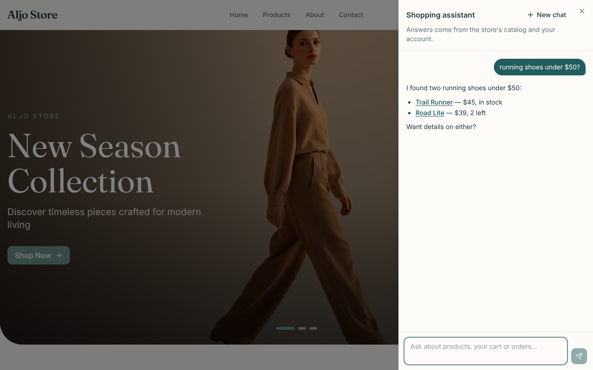
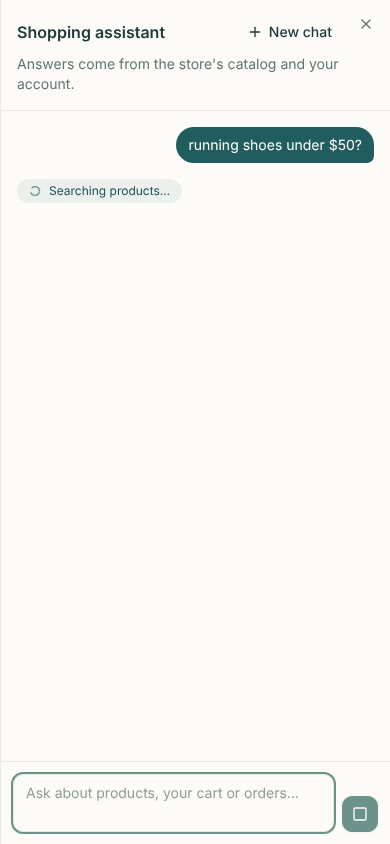

# 007 — Chat panel

| | |
|---|---|
| **Status** | Done |
| **Milestone** | M3 — Chat UI ([`phases.md`](../shopping-agent/phases.md)) |
| **Created** | 2026-10-10 |
| **Updated** | 2026-10-10 |
| **Closed by** | `mern-frontend` `d08968f` |
| **Repo** | Code in `mern-frontend`; the spec lives here with the other agent docs |

## Goal

A signed-in customer opens a chat panel from any store page, asks a question, and watches the assistant's answer stream in, with a status chip while a tool runs, product links that open the product page, and clear messages when something goes wrong. It talks to `POST /api/v1/agent/chat` from spec 006.

## Context

- **Backend contract (spec 006):**
  - **Request:** `POST /api/v1/agent/chat` with `{ message, threadId? }` and a Bearer token.
  - **Events streamed back:** `token { text }`, `tool_start { tool, label }`, `tool_end { tool, ok }`, `error { message, retryable }`, `done { threadId }`.
  - **Error responses:** 503 when the agent is off, 401 without a valid token, 400 for a bad body.
- **Frontend today:**
  - React 19, Vite, Tailwind 4, shadcn-style components in `src/shared/components/ui/`, including `sheet.tsx`.
  - `react-markdown` and `rehype-sanitize` are already installed.
  - Auth tokens live in `localStorage` (`accessToken`, `refreshToken`); the Redux `auth` slice holds `user` and `isAuthenticated`.
  - `apiFetch` sends the Bearer token but has no 401 → refresh handling ([`follow-ups.md`](../shopping-agent/follow-ups.md) §10).
  - Store pages render inside `PageLayout` (header, outlet, footer).
- **[`reconciliation.md`](../shopping-agent/reconciliation.md) Gap 14:** stream with `fetch` + `ReadableStream` (POST with a Bearer header), not `EventSource`.
- **Gap 16:** guests get a sign-in prompt instead of the chat.

## Scope

**In:**
- `src/features/shopping-agent/` in `mern-frontend`: the streaming client, an SSE parser, a `useAgentChat` hook, and the panel components.
- A launcher button on store pages (inside `PageLayout`), hidden unless `VITE_AGENT_ENABLED=true`.
- For the chat's own requests only: on a 401, try `/auth/refresh-token` once and retry; if that fails, ask the customer to sign in again.
- Tests with Vitest and Testing Library.

**Out:**
- **The confirm card** → M4. It needs the resume request, which the backend doesn't accept yet, so it ships with the first confirm-required tool.
- **The avatar upload flow** (`POST /uploads/avatar`, `PendingUpload`, the attach button) → its own spec with `upload_avatar` in M4. [`phases.md`](../shopping-agent/phases.md) M3 listed both; they move to keep this spec to the panel.
- Token refresh for the rest of the app ([`follow-ups.md`](../shopping-agent/follow-ups.md) §10).
- Product cards inside the chat; M3 renders links in Markdown. Cards can come later if wanted.
- Loading an old conversation's messages from the server (no history endpoint exists yet).

## Design

**Files** (`src/features/shopping-agent/`):

```
services/sse.ts              parse a text/event-stream body into { event, data } as chunks arrive
services/agent-chat.service.ts  streamChat({ message, threadId, signal }) → async iterator of events;
                                 401 → refresh once → retry; maps 503/400/network errors to typed failures
hooks/useAgentChat.ts        conversation state (useReducer): messages, streaming flag, tool status, error, threadId
components/ChatLauncher.tsx  floating button, bottom-right; signed in → opens the panel; guest → sign-in prompt
components/ChatPanel.tsx     the Sheet: header (title, New chat, close), MessageList, Composer
components/MessageList.tsx   bubbles, auto-scroll, aria-live="polite"
components/AssistantMessage.tsx  react-markdown + rehype-sanitize; relative links → router <Link>
components/ToolStatus.tsx    chip with the tool_start label while a tool runs
components/Composer.tsx      textarea (Enter sends, Shift+Enter newline, 2,000-char limit), Send / Stop
index.ts
```

**Conversation state** (`useAgentChat`):
- `messages`: `{ id, role: 'user' | 'assistant', text, status: 'streaming' | 'done' | 'error' }[]`.
- Sending:
  1. Append the user message and an empty assistant message.
  2. `token` events append to the assistant message.
  3. `tool_start` sets the chip; `tool_end` clears it.
  4. `done` stores `threadId` and marks the message done.
- `error`: the assistant message ends with the event's message. When `retryable` is true, a **Try again** button resends the same text.
- **Stop:** aborts the request (`AbortController`); the partial answer stays, marked as stopped. The backend cancels the turn when the connection closes (spec 006).
- **New chat:** clears messages and `threadId`.
- **Persistence:** `threadId` and the displayed messages (last 50) are saved in `localStorage` under a key that includes the user id, so a reload keeps the conversation on screen. The server keeps the real memory, so this is display only. Signing out or switching user shows a fresh panel.
- One request at a time: Send is disabled while streaming.

**Failures shown to the customer:**

| Case | Shown |
|---|---|
| 503 (agent off) | "The shopping assistant isn't available right now." (no retry) |
| 401 after one refresh attempt | "Please sign in again to keep chatting." with a link to `/login` |
| 400 | The server's validation message |
| `error` event | Its `message`; **Try again** when `retryable` |
| Network failure or the stream ending without `done` | "The connection dropped. Try again." with **Try again** |

**Rendering safety:** assistant text renders through `react-markdown` with `rehype-sanitize`, never raw HTML ([`security.md`](../shopping-agent/security.md) §11):
- Links starting with `/` become React Router `<Link>`s and close the panel on mobile.
- Other links render as plain text: the agent only ever gives relative product links.
- Images in Markdown are not rendered.

**Launcher visibility:**

| Condition | What shows |
|---|---|
| `VITE_AGENT_ENABLED` isn't `true` | Nothing — the frontend's own switch, matching the backend's `AGENT_ENABLED` |
| Signed in | The launcher; opens the panel |
| Guest | The launcher; opens a small prompt with **Sign in** / **Create account** links instead of the chat |
| Admin pages (`DashboardLayout`) | Nothing — the launcher lives only in `PageLayout` |

**Layout:**
- Built on the existing `Sheet`: a full-height side panel on desktop (about 420 px wide) and full-screen on mobile.
- The panel stays open across page navigation, because it lives in `PageLayout`.
- Uses the site's existing Tailwind tokens; no new design system.

## Tasks

- [x] `sse.ts` + tests
- [x] `agent-chat.service.ts` (stream, refresh-once, typed failures) + tests
- [x] `useAgentChat` (tested through the panel tests)
- [x] Components; launcher in `PageLayout`; `VITE_AGENT_ENABLED` in `src/shared/config/env.ts` and `.env.example`
- [x] Component tests (below)
- [x] Manual check in the browser against a scripted backend (see Results); against the real model once a key exists
- [x] Update `phases.md` §0 and the spec index

## Acceptance criteria

- [x] SSE parsing handles events split across chunks, several events in one chunk, and comment lines — `sse.test.ts`
- [x] A streamed turn shows the user message, the tool chip during `tool_start`…`tool_end`, the answer growing token by token, and stores `threadId` from `done` — `chat-panel.test.tsx`
- [x] The next message sends the stored `threadId`; **New chat** sends none — test
- [x] 503, 400, `error` (retryable and not), a dropped stream, and 401 → refresh → retry (and 401 → refresh fails → sign-in prompt) each show the message in the table above — `agent-chat.service.test.ts` + `chat-panel.test.tsx`
- [x] **Stop** aborts the request and keeps the partial answer — test
- [x] Assistant Markdown can't inject HTML or scripts; relative links render as router links; absolute links render as text — test (`<script>`, `<b>`, images, an external link)
- [x] Guests see the sign-in prompt, not the chat; nothing renders when `VITE_AGENT_ENABLED` isn't `true` — tests
- [x] Reloading keeps the visible conversation for the same user; another user sees an empty panel — test
- [x] `npm run lint:eslint`, `npm run build` and `npm test` pass in `mern-frontend`; no snapshot changes were needed (the launcher renders nothing in tests unless the switch is on)

## Test plan

- **Unit tests:** `sse.ts`, and `agent-chat.service.ts` with a fake `fetch` that returns a `ReadableStream` written chunk by chunk.
- **Component tests:** the panel and hook with Testing Library, the same fake `fetch`, and the existing store test utilities (`src/shared/tests/test-utils.tsx`).
- **Manual:** run the backend locally with `AGENT_ENABLED=true` and the frontend with `VITE_AGENT_ENABLED=true`, using a scripted model for the backend if no key is set, and record a screenshot in Results.

## Open questions

_None — resolved 2026-10-10, see the decision log._

## Results

**2026-10-10** — `mern-frontend` commit `d08968f`.
- Tests: 45 passed (24 existing + 21 new: `sse.test.ts` 3, `agent-chat.service.test.ts` 5, `chat-panel.test.tsx` 13). ESLint 0 errors (3 existing warnings), Prettier clean, `npm run build` passes.
- **Browser check** (Chromium via Playwright): the real frontend (`vite`, `VITE_AGENT_ENABLED=true`) against a small fake backend that streams a scripted turn (`tool_start` → 1.2 s → `tool_end` → tokens → `done`), signed in with a stored token. No page errors on desktop (1280×800) or mobile (390×844). On mobile, tapping a product link opened the product page and closed the panel.

| Desktop, answer streamed | Mobile, tool running |
|---|---|
|  |  |

Not yet seen: a turn against the real agent (needs the backend running with `ANTHROPIC_API_KEY`).

## Decision log

| Date | Decision | Why |
|---|---|---|
| 2026-10-10 | Approved with the recommended default: the visible conversation persists across reloads in `localStorage` (last 50 messages, keyed by user id) | A reload shouldn't make an ongoing conversation vanish from screen while the server still remembers it |
| 2026-10-10 | The confirm card and the avatar upload flow are not in this spec | Moved to M4 when the spec was written (see Scope) |
| 2026-10-10 | The switch is read through `isAgentEnabled()` at render time, not a constant | Tests can turn it on and off with `vi.stubEnv` |
| 2026-10-10 | The saved conversation is keyed by the user id from the auth state, or from the access token's payload after a reload (the auth state keeps only tokens) | Without it, a reload would have no key and the conversation couldn't be restored for the right user |
| 2026-10-10 | A failed answer's **Try again** removes that question and answer, then sends the question again | Keeps one copy of the question on screen |
| 2026-10-10 | The repo's husky hooks didn't run in this environment (not executable); ESLint, Prettier and the commit-message format were checked by hand instead | Same checks the hooks would run |
