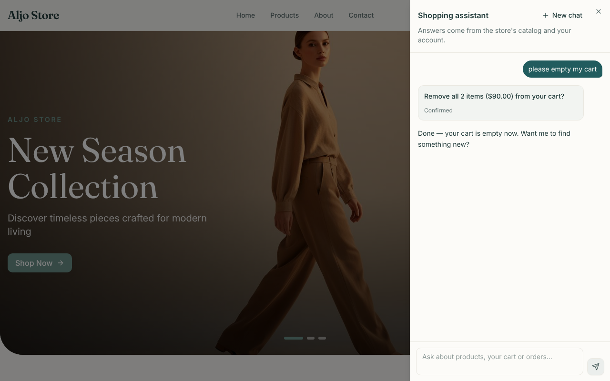

# 009 — Confirm card

| | |
|---|---|
| **Status** | Done |
| **Milestone** | M4 — Write tools + confirmation gate ([`phases.md`](../shopping-agent/phases.md)) |
| **Created** | 2026-10-10 |
| **Updated** | 2026-10-10 |
| **Closed by** | `mern-frontend` `daf99b4` + `7b26e98` |
| **Repo** | Code mostly in `mern-frontend`; one backend guard in `mern-backend` |

## Goal

When the agent asks for confirmation, the chat panel shows the server's summary with **Confirm** and **Cancel**. The customer's choice is sent as a resume request, and the result streams in. A new message can't be sent while a confirmation is waiting.

## Context

- **Spec 008:**
  - `clear_cart` pauses, and the backend streams `confirm_required { interruptId, tool, summary }`.
  - The answer is `POST /api/v1/agent/chat` with `{ threadId, resume: { interruptId, approved } }`.
  - Errors on that path are non-retryable: "That was already confirmed." and "There's nothing waiting for confirmation."
- **Spec 007:** the chat panel ignores `confirm_required` today.
- **Gap from 008:** a new message sent while a confirmation is pending would put a user message after an unanswered `tool_use`. The Claude API rejects that history, so the conversation would break. This spec closes it on the server and in the UI.

## Scope

**In:**
- The confirm card and the resume request in the chat panel.
- The composer is disabled while a confirmation is pending.
- Backend: a new message while a confirmation is pending gets a clear error instead of reaching the model.

**Out:**
- The other write tools (010–013).
- Token refresh for the rest of the app.

## Design

**Backend** (`src/agent/chat.service.ts`):
- One `pendingInterrupts(graph, thread)` helper serves both paths.
- **Message path:** if anything is pending → `error { message: 'Please confirm or cancel the pending action first.', retryable: false }` + `done`, without calling the model.
- **Resume path:** unchanged.

**Frontend** (`src/features/shopping-agent/`):

| File | Change |
|---|---|
| `types/index.ts` | `ChatMessage.confirmation?: { interruptId, tool, summary, state: 'pending' \| 'confirmed' \| 'declined' }` |
| `services/agent-chat.service.ts` | `streamChat` takes `{ message, threadId? }` or `{ resume, threadId }` and posts the matching body |
| `hooks/useAgentChat.ts` | `confirm_required` attaches a pending card to the current assistant message. `respond(messageId, approved)` marks the card, adds a new assistant message and streams the resume; `send` and `respond` share one stream loop. `pendingConfirmation` is exposed, and `send` refuses while it's set |
| `components/ConfirmCard.tsx` | Summary, **Confirm** / **Cancel**; after a choice, "Confirmed" / "Cancelled" |
| `components/MessageList.tsx`, `Composer.tsx`, `ChatPanel.tsx` | Render the card; disable the composer with a hint while pending |

The card's state is saved with the message, so a reload still shows a pending card. If it was answered elsewhere, the backend's "nothing waiting" error is shown.

## Tasks

- [x] Backend guard + test
- [x] Frontend types, service, hook, card, composer
- [x] Frontend tests
- [x] Browser check with a scripted backend; screenshots
- [x] Update `phases.md` §0 and the spec index

## Acceptance criteria

- [x] Backend: a message while a confirmation is pending → the error above, no model call; the confirmation can still be answered afterwards — HTTP test
- [x] `confirm_required` shows the card with the summary and no tool chip — test
- [x] **Confirm** posts `{ threadId, resume: { interruptId, approved: true } }`, disables the buttons, shows "Confirmed", and streams the result into a new assistant message — test and browser
- [x] **Cancel** posts `approved: false` and shows "Cancelled" — test
- [x] The composer is disabled while a card is pending and enabled after a choice — test and browser
- [x] A non-retryable resume error ("That was already confirmed.") shows without **Try again** — test
- [x] A pending card survives a reload for the same user and can still be answered — test
- [x] Backend: lint 0 errors, build, `npm test` 114 + 8 skipped / 122 with `MONGO_URL`. Frontend: 53 tests, ESLint 0 errors, Prettier clean, build

## Test plan

- **Frontend:** the fake streaming `fetch` from spec 007's tests.
- **Backend:** the existing confirmation block in `agent.routes.test.ts`.
- **Browser:** Playwright against a fake backend that streams the confirm flow.

## Open questions

_None — approved with the plan._

## Results

**2026-10-10** — `mern-frontend` `daf99b4`; backend guard in this repo.
- Frontend: 53 tests (45 → 53: 7 card tests, 1 resume-body test). Backend: 1 new HTTP test; 122/122 with MongoDB.
- **Browser check** (Chromium via Playwright, real frontend, fake backend streaming the confirm flow): the card appeared with the summary and the composer locked ("Confirm or cancel the action above first."); after **Confirm** the card read "Confirmed", the result streamed in, and the composer unlocked. No page errors.

| Pending | After Confirm |
|---|---|
|  |  |

## Decision log

| Date | Decision | Why |
|---|---|---|
| 2026-10-10 | Approved with the plan, including the backend guard | Without it, a message sent while a confirmation waits breaks the conversation |
| 2026-10-10 | If a confirmation answer never reaches the server (network, sign-in, stopped), the card goes back to pending and the failed reply has no **Try again** | "Try again" resends a question; for a confirmation the customer just presses Confirm or Cancel again. If the first answer did arrive, the server replies "already confirmed" |
| 2026-10-10 | `send` and `respond` share one stream loop (`runStream`) | Same event handling for new messages and confirmation answers |
