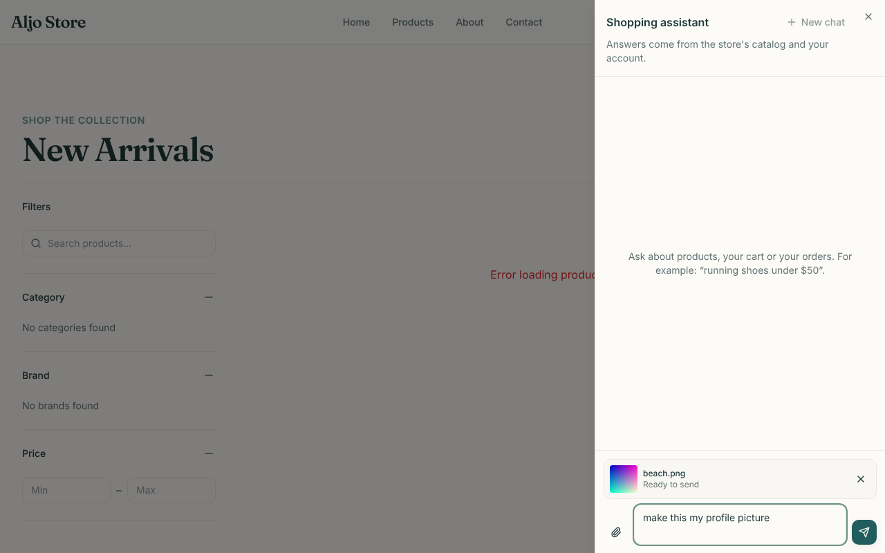
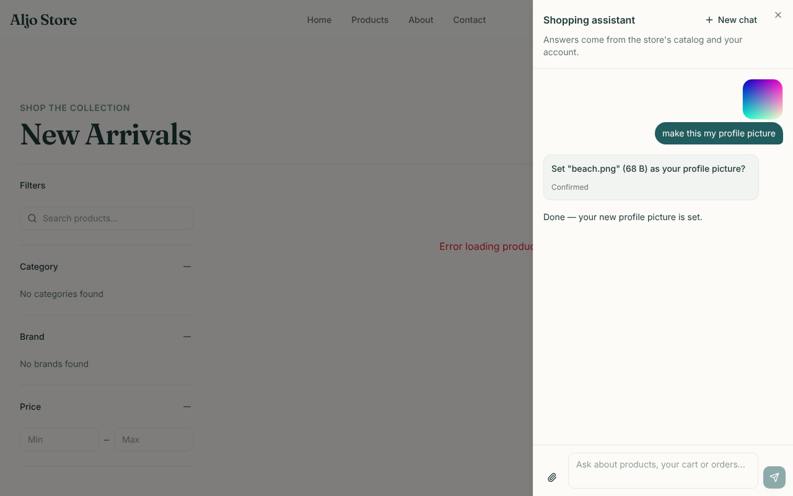

# 012 — Avatar upload

| | |
|---|---|
| **Status** | Done |
| **Milestone** | M4 — Write tools + confirmation gate ([`phases.md`](../shopping-agent/phases.md)) |
| **Created** | 2026-10-10 |
| **Updated** | 2026-10-10 |
| **Closed by** | `8db0052` + `mern-frontend` `5514a92` |
| **Repo** | `mern-backend` (upload endpoint, model, tool) and `mern-frontend` (attach button) |

## Goal

A customer can attach a picture in the chat and ask the agent to make it their profile picture. After they confirm, it's set exactly as the Edit Profile page sets it. The agent never sees the image's bytes, only an opaque id that works for that customer alone.

## Context

- **Design:** [`reconciliation.md`](../shopping-agent/reconciliation.md) Gap 11 ("Design for M3", moved to M4 by spec 007); [`security.md`](../shopping-agent/security.md) §9 ("File uploads never reach the LLM"); [`architecture.md`](../shopping-agent/architecture.md) §4 (`upload_avatar` row, confirm-required).
- **What exists:**
  - **Avatar rules** in `src/middlewares/multer.middleware.ts`: `uploadSingleFile` accepts one JPEG, PNG, GIF or WEBP file of up to 2 MB, in form field `profile`. Anything else gets a 400 with a message.
  - **`updateUserProfile(userId, name?, file?)`** in `src/services/auth.service.ts` uploads a multer file to Cloudinary (400×400, face crop), saves `user.profile`, and returns `{ id, name, email, profile }`.
  - **Spec 008–011 plumbing** this reuses: the confirmation gate and card, the per-user tools, the audit log, and the header name refresh.
- **What's missing:** a way to get an image from the chat to the server without the model handling it. That means an upload endpoint, a short-lived holding record, the tool, and an attach button.

## Scope

**In:**
- `POST /api/v1/agent/uploads/avatar`.
- A `PendingUpload` model with a 1-hour TTL.
- `applyAvatarUpload(userId, uploadId)`.
- The `upload_avatar` tool (confirm-required).
- An optional `uploadId` on chat messages.
- Prompt and `PROMPT_VERSION` 5.
- Frontend: an attach button, a thumbnail, the upload call, and a header avatar refresh.

**Out:**
- Other image uses, such as "find products like this photo".
- Removing a profile picture.
- `cancel_order` (013).

## Design

**Upload endpoint** — `POST /api/v1/agent/uploads/avatar` on the agent router, behind `agentAvailable` and `authMiddleware` like the chat:
- It runs the existing `uploadSingleFile` middleware (same limits and messages; form field `profile`).
- It stores a `PendingUpload { user, kind: 'avatar', data (Buffer), mimeType, size, originalName, createdAt }`, which expires after 1 hour through a TTL index on `createdAt`.
- It responds `201 { uploadId, name, size }`.
- Nothing reaches Cloudinary or the profile at this point.

**Chat request:** `{ message, threadId?, uploadId? }`. When `uploadId` is present, the server:
- loads the `PendingUpload` by `{ _id: uploadId, user }`; if it's missing or not this user's → `400 "That attachment has expired. Please attach it again."`
- appends a fixed note to the customer's message: *[The customer attached an image: "photo.png", 340 KB. upload_id: <id>]*

The note is written by the server, and the id is opaque and owner-scoped. That is the only way the model learns the id.

**Tool** — `upload_avatar({ upload_id })`, confirm-required (`src/agent/tools/account-writes.ts`, beside `update_profile`):
- **Confirmation summary** (read-only): *Set "photo.png" (340 KB) as your profile picture?* If the upload is gone → *That picture has expired. Cancel and attach it again.*
- **Runs `applyAvatarUpload(ctx.userId, upload_id)`** (`src/services/upload.service.ts`, new):
  1. `PendingUpload.findOne({ _id, user, kind: 'avatar' })`; nothing found → error "That picture has expired or isn't yours."
  2. Pass a multer-shaped file (`{ buffer, mimetype, originalname, size }`) to `updateUserProfile(userId, undefined, file)`.
  3. Delete the upload after success. If Cloudinary fails, the upload is kept so the customer can confirm again.
- **Returns** `{ profilePictureUpdated: true }`. The picture's URL isn't returned to the model.

**Prompt:** the assistant can set an attached image as the profile picture with `upload_avatar`, using the `upload_id` from the attachment note. It never invents an id. `PROMPT_VERSION` becomes 5.

**Frontend** (`src/features/shopping-agent/`):

| Change | Detail |
|---|---|
| **Composer** | Paperclip button + hidden file input (`accept` the four types). The 2 MB limit and type are checked in the browser first; the server re-checks |
| **Upload** | `uploadAvatar(file)` posts `FormData` (`profile` field) to the upload endpoint with the Bearer token, using the same refresh-once-on-401 as the chat |
| **Attachment chip** | Shows the thumbnail (object URL), name and a remove (×) button above the text box while uploading or ready |
| **Sending** | The message goes with `uploadId`. With no text, it defaults to "Here's a picture." The user's bubble shows the thumbnail; after a reload only the file name shows, since object URLs don't persist |
| **After `upload_avatar` succeeds** | The profile refresh from spec 011 also updates `profile` (the avatar URL) in the auth state |

## Tasks

- [x] `PendingUpload` model + TTL; `upload.service.ts` (`createAvatarUpload`, `applyAvatarUpload`)
- [x] Upload route + controller on the agent router
- [x] Chat `uploadId`: ownership check + server-written note
- [x] `upload_avatar` tool, summary, label; prompt + `PROMPT_VERSION` 5
- [x] Frontend: attach button, upload service, chip, bubble thumbnail, avatar refresh
- [x] Tests (below); browser check
- [x] Update `phases.md` §0 and the spec index

## Acceptance criteria

- [x] **Upload limits:** an upload over 2 MB, of a wrong type, or with two files → 400 with the existing messages; without a token → 401; agent off → 503 — HTTP tests
- [x] **Ownership:**
  - [x] An upload is stored for its owner only.
  - [x] Another user's `uploadId` in a chat message → 400 "expired" (no note added).
  - [x] `applyAvatarUpload` with another user's id → error.
  - [x] Covered by HTTP and MongoDB tests.
- [x] `upload_avatar` pauses with its summary, and on confirm calls `updateUserProfile` with the stored bytes and type, then deletes the upload — tool tests (Cloudinary mocked)
- [x] A Cloudinary failure keeps the upload, and confirming again can succeed — tool test
- [x] Uploads expire: the TTL index exists on `createdAt` (3,600 s) — MongoDB test
- [x] The model never receives image bytes or the stored URL: tool results and the attachment note contain only the id, name and size — tests
- [x] **Frontend:**
  - [x] An oversize or wrong-type file is refused in the browser.
  - [x] The upload posts `FormData` with the token.
  - [x] The chip shows and can be removed.
  - [x] The message carries `uploadId`.
  - [x] The avatar refresh runs after `upload_avatar`.
  - [x] Covered by tests.
- [x] Backend lint 0 errors, build, `npm test` 139 + 19 skipped / 158 with `MONGO_URL`; frontend 64 tests, ESLint 0 errors, Prettier, build; a browser check against a scripted backend

## Test plan

- **Backend:** HTTP tests with real multipart requests (like `multer.middleware.test.ts`), a MongoDB block for `PendingUpload` and ownership, and tool tests with `updateUserProfile` mocked.
- **Frontend:** component tests with a fake `fetch`.
- **Browser:** Playwright with a scripted backend, as in specs 007 and 009.

## Open questions

_None — resolved 2026-10-10, see the decision log._

## Results

**2026-10-10** — backend in this repo; frontend `mern-frontend` `5514a92`.
- **Backend:** `PendingUpload` model (1 h TTL), `src/services/upload.service.ts`, the upload route, the chat `uploadId` check and note, the `upload_avatar` tool, prompt and `PROMPT_VERSION` 5.
- **New tests:**
  - backend: 4 tool tests, 5 HTTP tests (upload limits, 401, 503, another user's `uploadId`, the attachment note), and `src/services/upload.service.mongo.test.ts` (5: ownership, apply-then-delete, failure keeps the upload, TTL index)
  - frontend: 7 component tests and 2 service tests (55 → 64)
- **Example:**
  - the note the model sees: *[The customer attached an image: "beach.png", 340 KB. upload_id: 6720…]*
  - the confirmation: *Set "beach.png" (340 KB) as your profile picture?*
- **Browser check** (Chromium via Playwright, real frontend, fake backend; signed in through the login form):
  - the chip showed "Ready to send" after the upload; the fake backend saw a multipart body with a `profile` field and a Bearer token
  - the message went with `uploadId`, and the bubble showed the thumbnail
  - after **Confirm** the header avatar changed to the new picture; no page errors

| Attached | Confirmed | Header after |
|---|---|---|
|  |  |  |

- **Not yet seen:** a real Cloudinary upload through the tool. It uses the same `updateUserProfile` as the Edit Profile page, and is part of the parked live check.

## Decision log

| Date | Decision | Why |
|---|---|---|
| 2026-10-10 | Approved. Endpoint `POST /api/v1/agent/uploads/avatar` | Behind the agent's on/off switch; only the chat uses it |
| 2026-10-10 | Uploads expire after 1 hour | As reconciliation Gap 11 proposed; long enough to confirm, short enough not to keep images around |
| 2026-10-10 | The image is uploaded as soon as it's picked, not when the message is sent | Sending stays quick, and a refused file shows its error in the chip before anything is sent |
| 2026-10-10 | "Try again" on a failed message resends its attachment too | The `uploadId` is kept on the message; the server rechecks ownership and expiry |
| 2026-10-10 | The file name in the attachment note has quotes and brackets removed | The name is customer-supplied text; it can't close the note or fake a second one |
